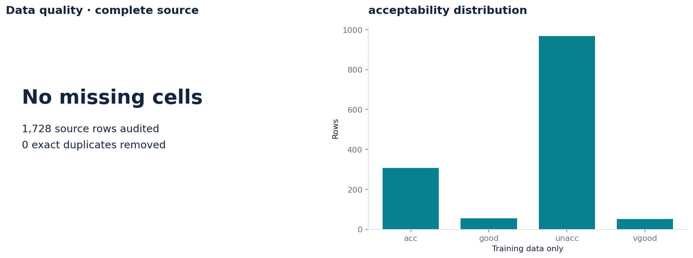
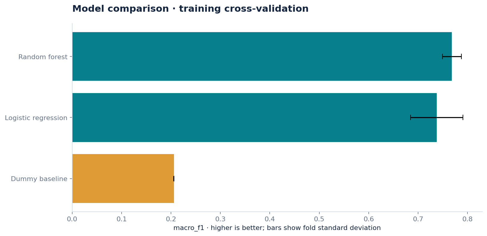
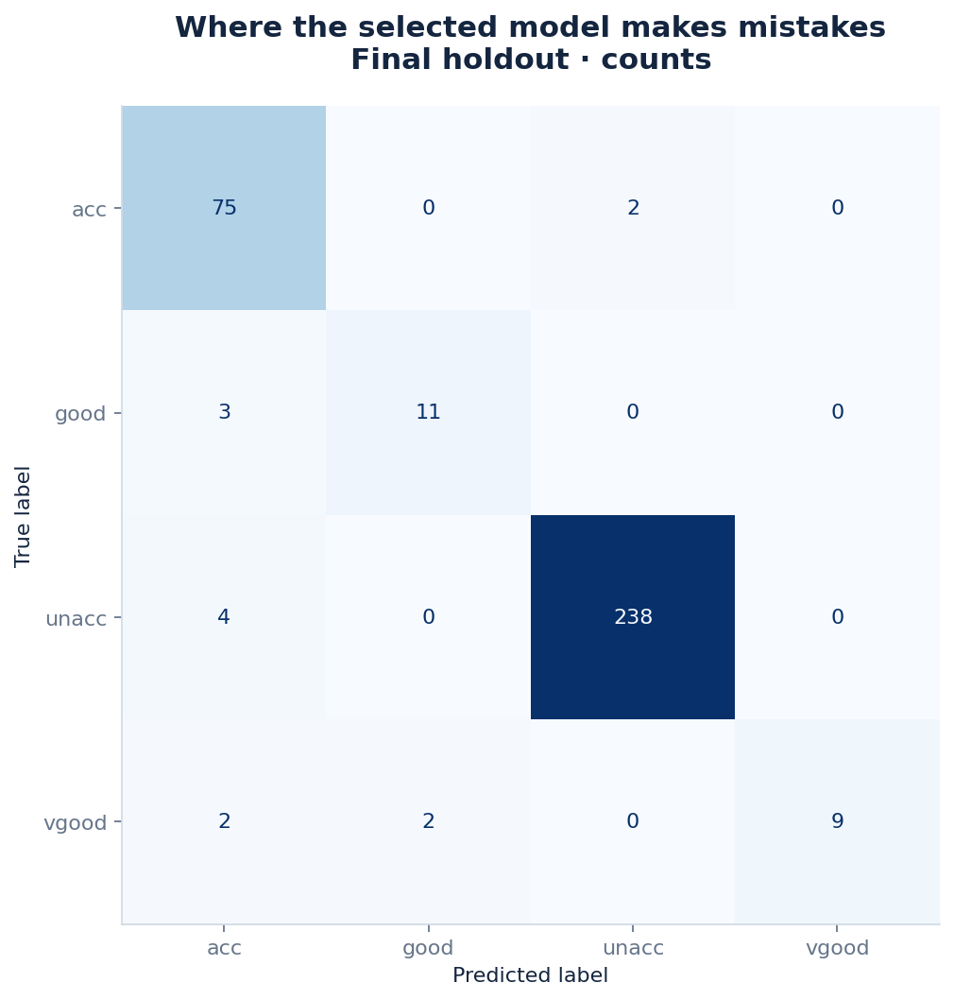
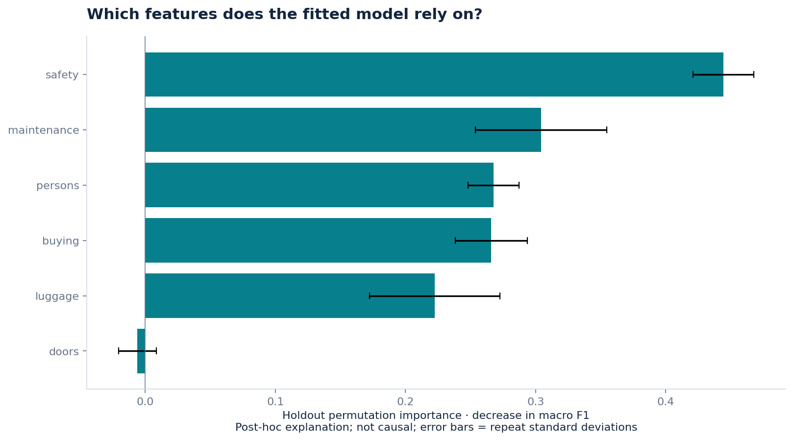

# Car Acceptability Classification

Evaluate how well categorical vehicle attributes recover four car-acceptability classes from the UCI Car Evaluation decision model.

---

## Overview

* **Task:** Multi-class classification across four labels: `unacc`, `acc`, `good`, and `vgood`.
* **Dataset:** 1,728 samples, 6 categorical features.
* **Selected Model:** **Random Forest** (holdout Macro-F1 = 0.8881).
* **Baseline Comparison:** Dummy baseline achieved holdout Macro-F1 = 0.2058.

Automated study completed on 2026-09-11; human review pending.

---

## Key Results

### Training Cross-Validation

| Model | Macro-F1 | Fold SD |
| :--- | :--- | :--- |
| **Random Forest** | **0.7685** | 0.0191 |
| Logistic Regression | 0.7378 | 0.0528 |
| Dummy Baseline | 0.2060 | 0.0003 |

Model selection used 3-fold stratified cross-validation on 1,382 training samples (seed 42). Preprocessing was fitted within each training fold. Fold SD describes variation across folds; it is not a confidence interval. The best CV score is subject to model-selection optimism.

### Final Holdout Evaluation (346 Samples)

| Model | Macro-F1 | Accuracy | Balanced Accuracy |
| :--- | :--- | :--- | :--- |
| **Random Forest** | **0.8881** | **0.9624** | **0.8589** |
| Dummy Baseline | 0.2058 | 0.6994 | 0.2500 |

The stratified random holdout was evaluated only after model selection, using the frozen winner and dummy baseline. Higher values are better for all three metrics.

The selected model made **13 errors out of 346 predictions**. The least-recalled class was `vgood` (recall = 0.6923 across 13 samples), showing why accuracy alone is insufficient.

The approximate 95% bootstrap interval for holdout Macro-F1 was **0.8119–0.9457**, based on 200 stratified resamples. It is conditional on the fitted model and split and excludes training and model-selection uncertainty.

---

## Data Summary

* **Source:** [UCI Car Evaluation](https://archive.ics.uci.edu/dataset/19/car+evaluation). Distributed under CC BY 4.0. Source attribution is recorded in `SOURCE.md`.
* **Data Quality:** 1,728 usable rows, 6 features, 0 missing cells, 0 duplicates removed.
* **Key Feature:** `safety` showed the highest mean permutation importance drop (**0.4443 Macro-F1** across 5 repeats). This measures model reliance, not a causal effect; correlated predictors can share importance.
* **Collinearity / Notes:** All six predictors are categorical; no numeric Pearson correlation matrix or numeric descriptive-statistics file was generated. These labels come from a rule-based evaluation model, not observed purchase behavior. Benchmark accuracy is not a measure of consumer preference.

---

## Visualizations

| Data Quality and Class Distribution | Training Cross-Validation |
| :---: | :---: |
|  |  |

| Holdout Confusion Matrix | Permutation Feature Importance |
| :---: | :---: |
|  |  |

---

## Repository Structure

```text
├── figures/                   # Diagnostic, performance, and distribution plots
├── analysis.ipynb             # Pipeline walkthrough; exported code cells are unexecuted
├── audit.json                 # Missingness, duplicates, exclusions, and usable row counts
├── data_dictionary.csv        # Column types, roles, missingness, and unique-value counts
├── error_analysis.csv         # Misclassified holdout samples and confidence scores
├── feature_importance.csv     # Permutation importance means and standard deviations
├── metrics.json               # CV, holdout, and training scores
├── predictions.csv            # All holdout predictions and confidence scores
├── project.json               # Dataset specification, configuration, versions, and hashes
├── splits.json                # Training, holdout, and cross-validation row indices
├── snapshot.csv.gz            # Exact analyzed dataset snapshot
├── SOURCE.md                  # Dataset source, license information, and snapshot checksum
├── LEARNING_NOTES.md          # Human review and experiment notes
├── report.html                # HTML report referencing the figure files
└── README.md
```
